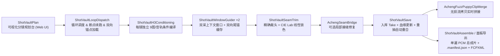

<div align="center">

# ComfyUI-Acheng-ShotVault (v5.8)

**面向 MiniMax H3 长视频分段制作的工业级可视化分镜规划、无损续拍、双向桥接单段重抽与成片封装节点套件**

<p>
  <a href="README.md">English</a> | <strong>简体中文</strong>
</p>

[](LICENSE)
[](https://github.com/AharaOoO/ComfyUI-Acheng-ShotVault/releases)
[](https://github.com/comfyanonymous/ComfyUI)
[](https://www.python.org/)

</div>

---

## 目录

1. [核心架构与能力矩阵 (v5.8)](#一核心架构与能力矩阵-v58)
2. [节点总览（内置 10 个核心节点）](#二节点总览内置-10-个核心节点)
3. [安装指南（一键 `git clone` 即用）](#三安装指南一键-git-clone-即用)
4. [示例工作流与第三方配套节点清单](#四示例工作流与第三方配套节点清单)
5. [从零上手：完整使用流程](#五从零上手完整使用流程)
6. [进阶特性详解（双向桥接 / 防劣化 / 成片闭环）](#六进阶特性详解)
7. [常见问题与生产排雷 (FAQ)](#七常见问题与生产排雷-faq)
8. [开源协议、作者维权声明与免责条款](#八开源协议作者维权声明与免责条款)

---

## 一、核心架构与能力矩阵 (v5.8)



### v5.8 关键工程特性

| 模块 | 核心解决的痛点 | v5.8 实现方案 |
| :--- | :--- | :--- |
| **可视化分镜规划台** | 传统多段脚本难管理、文武戏无法混排、改一行全盘重跑 | 节点内嵌完整控制台：支持 `&时长&` + `===` 自动分段、`@cut@` / `@continue@` 显式切镜、每镜独立文武戏路由与 9 图参考槽、自由安全缩放（`紧凑/标准/宽屏`）、全屏专注提示词编辑器（`Ctrl+Enter` 保存）与中英双语实时切换 |
| **双向桥接单段重抽** | 改中间一镜导致与后一段脱节、下游整条链路标红作废 | 支持 **尾接下一段纯净首部（关 / 1帧 / 5帧 / 22帧）**：直接从下一段已裁头成品 MP4 提取无彩噪首帧，严格对齐 H3 `17k+5` 潜空间网格与 `cycle_pos == 0` 相位；`22f` 可选反向渐进微噪（接缝 `pos=0` 零噪），完成后下游血缘自动恢复绿标 `VALID` |
| **成片导出同步闭环** | 重启 ComfyUI 或单段重抽后，旧 `master.mp4` 未更新导致误下旧片 | 每次导出原子写入伴生 `.manifest.json` 校验清单；支持重抽后**自动重合成片**；顶栏实时检测过期镜头并高亮 `导出成片 · 待更新`，导出弹窗自动拦截误下旧版 MP4 |
| **固定机位防劣化策略** | 数字人 / 固定机位多轮 `@continue@` 叠加彩噪引发画质脏糊、背景包浆 | 内置三档防劣化策略（标准 / 温和防劣化 / 强保静态背景）+ 周期插 `@cut@` 清零工具，压制静态背景世代衰减 |
| **本地接缝修复与无损拼接** | 分段拼接偶发亮度微跳、硬切误修或全片重复重编码损耗画质 | 集成 `AchengSeamBridge` + `AchengFuzzPuppyClipMerge`：双门控硬切保护、多时刻稠密光流局部对齐、可选本地 RIFE 桥接，历史已拼片段零重编码流拷贝 |
| **数据安全与非破坏性管理** | 误删历史 Take 难找回、多工程目录越权污染 | 全部历史版本按 `project.json` + `.h3ctx.safetensors` 独立归档；清理操作强制走系统回收站（`send2trash`）；全路径严格根沙箱校验 |

---

## 二、节点总览（内置 10 个核心节点）

> [!NOTE]
> **🧪 实验功能说明（接缝修复）**：接缝修复功能（Tab ② 单镜修缝、`AchengSeamBridge` 及 `AchengFuzzPuppyClipMerge` 的 `enable_repair` 开关）目前处于**实验性阶段**，**仅适用于画面机位与分镜保持不变时，因续接生成导致的画面突变修补**。日常常规多切镜创作保持默认关闭（`OFF`）即可，平时基本无需开启。

安装本仓库即可在 ComfyUI 中直接获得以下 **10 个原创节点**（`8` 个 ShotVault 主流程节点 + `2` 个内置 SeamBridge 接缝/合并节点）：

| 节点类名 (`Class`) | 显示名称 | 核心职责 |
| :--- | :--- | :--- |
| `ShotVaultPlan` | **ShotVault Plan (可视化分镜规划/音轨编排)** | 主控分镜规划节点，内置交互式 Web 面板，输出 `shot_pipe`、`total_shots`、`plan_summary_json` |
| `ShotVaultLoopDispatch` | **ShotVault Loop Dispatch (循环调度与双向取帧)** | 配合 `forLoop` 逐镜派发提示词、Seed、参考图、上一段尾上下文与下一段纯净首部锚点；支持断点跳过已有效镜头与单段定向锁镜 |
| `ShotVaultH3Conditioning` | **ShotVault H3 Conditioning (H3 多模态条件封装)** | 严格按当前镜头的 9 图槽位与音频参考动态构建 H3 条件 |
| `ShotVaultWindowGuider` | **ShotVault Window Guider (双采上下文窗口引导)** | 管理一采/二采共享头尾潜空间缓存、双向尾锚注入与反向渐进微噪；默认 `window_mode=off` 走 H3 原生全长单窗（支持 15s/25s/30s+ 零重复），低显存手动开启滑窗时内置全局 RoPE 偏移与高噪步去伪锚 |
| `ShotVaultSeamTrim` | **ShotVault Seam Trim (精确裁头与 Lab 线性锁色)** | 按 `22f / 39f / 56f` 精准裁切重叠引导区，并执行 CIE Lab MKL 线性色彩锁定与接缝质检 |
| `ShotVaultSave` | **ShotVault Save (分镜入库与自动重合)** | 原子保存单镜 MP4（全流程单遍 H.264 编码）并零重编输出 `video` 端口供下游预览/合并，同步写缩略图、接缝对比预览与 `.h3ctx.safetensors`；更新血缘 DAG 并支持单段重抽自动刷新总成片 |
| `ShotVaultAssemble` | **ShotVault Assemble (总成片单遍无漂移封装)** | 零音画漂移单遍 PCM/AAC 封装完整 `master.mp4`（单段无偏移走 `< 0.05s` 原子直拷快路径）、`.manifest.json` 同步清单、达芬奇 `FCPXML` 与 `master_video` 端口 |
| `ShotVaultLoad` | **ShotVault Load (已存镜头读取)** | 按工程名与镜号直接读取已归档的指定 Take 视频与上下文 |
| `AchengSeamBridge` | **Acheng Seam Bridge · 接缝修复** | 生成后/编码前局部单点接缝修复（支持 `off / auto / align_color / flow / rife`），内置硬切保护 |
| `AchengFuzzPuppyClipMerge` | **Acheng FuzzPuppy Clip Merge · 视频无缝合并** | 替代原生 `ConcatenateVideo`：仅解码相邻两段边界，历史已合并视频零重编码流拷贝，并支持与 `shot_pipe` 修缝开关联动 |

---

## 三、安装指南（一键 `git clone` 即用）

### 方式 1：Git 安装（推荐，便于后续 `git pull` 更新）

```bash
cd ComfyUI/custom_nodes
git clone https://github.com/AharaOoO/ComfyUI-Acheng-ShotVault.git
```

安装依赖（标准 ComfyUI 便携版通常已预装大部分依赖，执行一次补齐即可）：

```bash
# Windows 便携版示例（在 ComfyUI_windows_portable 目录运行）：
.\python_embeded\python.exe -m pip install -r .\ComfyUI\custom_nodes\ComfyUI-Acheng-ShotVault\requirements.txt

# 独立 Python / venv 环境示例：
pip install -r ComfyUI/custom_nodes/ComfyUI-Acheng-ShotVault/requirements.txt
```

### 方式 2：ZIP 下载安装

1. 点击本仓库右上角 **Code → Download ZIP**（或前往 [Releases](https://github.com/AharaOoO/ComfyUI-Acheng-ShotVault/releases) 下载对应版本）。
2. 解压到 `ComfyUI/custom_nodes/ComfyUI-Acheng-ShotVault`（确保 `__init__.py` 直接位于该目录下）。
3. 按上方命令补齐依赖，**重启 ComfyUI**，浏览器按 **`Ctrl + F5`** 强制刷新前端脚本。

### 已内置 ONNX RIFE 接缝修复模型

本仓库已直接内置 MIT 开源许可的轻量级插帧权重 `seam_bridge/models/rife422lite_fp32.onnx`（约 18.5 MB，源自 [Practical-RIFE](https://github.com/hzwer/ECCV2022-RIFE)），只要你的 ComfyUI Python 环境已安装 `onnxruntime`（或 `onnxruntime-gpu`），即可开箱使用 `AchengSeamBridge` / `AchengFuzzPuppyClipMerge` 的 RIFE 接缝修复功能。

模型查找顺序：
- `ComfyUI/custom_nodes/ComfyUI-Acheng-ShotVault/seam_bridge/models/rife422lite_fp32.onnx`（已内置）
- `ComfyUI/models/rife/rife422lite_fp32.onnx`（可选共享覆盖目录）
- 已安装的 `ComfyUI-Frame-Interpolation` 本地 `.pth` 权重（自动回退）

---

## 四、示例工作流与第三方配套节点清单

本仓库内置了经完整脱敏清洗、默认恢复常规 22 帧模式且全节点附带中英双语注释的 **H3 文武互斥 + 舞蹈模式（六路 LoRA · 五档双采）示例工作流模板**：

- [`example_workflows/ShotVault_v5.8_H3_DualCore_Clean_Template.json`](example_workflows/ShotVault_v5.8_H3_DualCore_Clean_Template.json)

### 内置六路 LoRA 路由 & 五档双采步数矩阵

模板内置 **五档 `SplitSigmas` 步数矩阵** 与 **六条独立 LoRA 链**，支持按镜自动文武互斥，并新增全局 **💃 舞蹈模式** 布尔开关（`#332`，**默认关闭**，关闭时 `easy ifElse` 零干扰直通文武四路）：

| 档位 / 模式 | 总步数与拆分 | 交接 Sigma | 一采 / 二采采样器 | LoRA 路由摘要 |
| :--- | :--- | :--- | :--- | :--- |
| **⚔️ 武戏默认** | `14` 步（`8 + 6`） | `0.815` (`#129`) | `er_sde` → `lcm` | 一采：Ref2V 8s `0.85` → FL2V 8s `0.50` → Combat V2 `0.65` → Motion Repair `0.50` → 受击反应 `0.35` → 速度滑块 (`#27`)<br/>二采：T8 DMAD 4s r39 `0.80` → Combat V2 `0.65` → Motion Repair `0.35` → 受击反应 `0.35` → 速度滑块 (`#27`) |
| **⚡ 武戏提速** | `12` 步（`6 + 6`） | `0.885` (`#131`) | `er_sde` → `lcm` | 沿用武戏双采链；打开控制区 `武戏_12步档`（`#28`）生效 |
| **🎭 文戏默认** | `12` 步（`6 + 6`） | `0.885` (`#133`) | `er_sde` → `lcm` | 一采：DMAD 8s Critic `1.00` → Combat V2 `0.60` → 真实质感影帝表演 `0.35` → Licon-VBVR `0.45`<br/>二采：DMAD 4s r39 `1.00` → Combat V2 `0.35` → Licon-VBVR `0.35` |
| **🚀 文戏极速** | `10` 步（`4 + 6`） | `0.923` (`#135`) | `er_sde` → `lcm` | 沿用文戏双采链；打开控制区 `文戏_10步档`（`#29`）生效 |
| **💃 舞蹈模式（可选）** | `14` 步（`10 + 4`） | `0.690` (`#358`) | `er_sde` → **`er_sde`** | 打开 `#332` 舞蹈模式生效（默认关闭）：一采 Ref2V 8s `0.85` → FL2V 8s `0.50` → DANCE `0.65` → 舞蹈卡点滑块 `1.35` → Motion Repair `0.30` → MysticXXX `0.35`；二采 FL2V 4s v1.2 r64 `1.00` → DANCE `0.65` → 舞蹈卡点滑块 `0.35` → Motion Repair `0.30` → MysticXXX `0.35` |

### 配套第三方公共节点（请通过 ComfyUI Manager 安装）

示例工作流除本仓库内置的 10 个节点外，还配合使用了以下优秀开源社区节点（均保持独立安装，版权归各自原作者所有）：

| 第三方节点包 | 用途 | 开源协议 / 获取方式 |
| :--- | :--- | :--- |
| **[ComfyUI-H3-Context-Noise](https://github.com/beijinren/ComfyUI-H3-Context-Noise)** | `#106 MiniMaxH3ContextTaperNoise`（H3 续接渐进彩噪抗色漂） | MIT（Copyright © 2026 beijinren），请独立安装 |
| **[ComfyUI-KJNodes](https://github.com/kijai/ComfyUI-KJNodes)** | `GetNode / SetNode / MiniMaxLowVRAMAttention / VRAM_Debug` | GPL-3.0，ComfyUI Manager 安装 |
| **[ComfyUI-Easy-Use](https://github.com/yolain/ComfyUI-Easy-Use)** | `easy forLoopStart / forLoopEnd / ifElse / convertAnything` | GPL-3.0，ComfyUI Manager 安装 |
| **[ComfyUI-Custom-Scripts](https://github.com/pysssss/ComfyUI-Custom-Scripts)** | `ShowText\|pysssss` 文本状态展示 | MIT，ComfyUI Manager 安装 |
| **[Goohaitools-comfyui](https://github.com/goohai/Goohaitools-comfyui)** | `GoohaiUniversalSlider` 快捷挡位切换 | 见上游仓库，ComfyUI Manager 安装 |
| **comfyui-minimax-h3-audio-T8** | `MiniMaxH3LoRACompatibilityLoaderT8Advanced / SemanticBridge` | 见上游仓库 |

> **模型提示**：示例工作流中的 UNET / CLIP / VAE / LoRA 下拉菜单仅为参考占位文件名，载入工作流后请切换为你本机 `ComfyUI/models/` 实际存放的 MiniMax H3 模型与 LoRA。

---

## 五、从零上手：完整使用流程

1. **载入工作流**：将 `example_workflows/ShotVault_v5.8_H3_DualCore_Clean_Template.json` 拖入 ComfyUI 画布，并确认模型下拉菜单已选择本机对应权重。
2. **新建项目**：在 **`ShotVault 分镜规划 v5.8`** 节点顶部修改项目名（如 `MyFilm_01`），所有单镜、历史 Take、上下文与成片将自动归档至 `ComfyUI/output/ShotVault/<项目名>/`。
3. **编排分镜与参考图（Tab ① 分镜编排 & 9图参考）**：
   - 可展开顶部总脚本框，使用标准分隔语法一键自动拆镜：
     ```text
     & 8 &
     @cut@
     第一镜提示词描述...
     ===
     & 8 &
     @continue@
     第二镜续接提示词描述...
     ```
   - 也可直接在条带中点击 **`+ 新增片段`** 逐镜编辑；点击提示词框右上角 **`⛶ 放大编辑`** 可开启全屏专注编辑器（`Ctrl+Enter` 保存 / `Esc` 关闭），底部支持拖拽调整文本框高度。
   - 在每镜右侧配置独立 9 图参考槽，或切到 **Tab ③ 全局 9 图池** 统一继承。
   - 按需点击每镜的 **⚔ 武戏流 / 🎭 文戏流** 按钮，工作流将按镜自动互斥路由对应的一采/二采 LoRA 链与步数矩阵（制作卡点舞蹈 MV 时可打开操控台 **💃 舞蹈模式** 开关 `#332`，自动切至 `10+4` 步、舞蹈双采 LoRA 链与二采 `er_sde`）。
4. **整片生成与断点续跑**：
   - 点击 ComfyUI 右上角 **运行**。每跑完一段立即落盘并入库；若中途中断，重新点击运行会自动跳过已 `VALID` 镜头并从中断镜无缝续跑。
5. **选片、单段重抽与修缝（Tab ② 选片重抽与修缝）**：
   - 点击顶部镜号切换镜头，在右侧 **历史版本 (Takes)** 随时试看对比并切换采用版本，废片可一键移入回收站。
   - 需要单独重抽某镜时，勾选 **启用单段重抽锁定**，选择随机新 Seed 或指定 Seed、可选填微调提示词，按需设置 **尾接下一段（关 / 1帧 / 5帧 / 22帧）** 并保持勾选 **重抽完成后自动重合成片**，然后点击 ComfyUI 右上角 **运行**。
6. **一键导出总成片**：
   - 点击节点顶栏 **`🎬 导出成片`**（如有新重抽或换片未同步，会自动高亮提示 **`🎬 导出成片 · 待更新`**），可一键合成/下载最新 `master.mp4` 及达芬奇 `FCPXML` 工程文件。

---

## 六、进阶特性详解

### 1. 双向桥接单段重抽（`0 / 1 / 5 / 22f`）原理
- **为什么不会引入彩噪污染？**
  下一段用于尾部锚定的参考帧并非来自旧采样潜空间，而是由 `load_next_shot_head_ref` 直接从下一段**已裁头、已交付的纯净成品 `shots/shot_xxxx_take_yyy.mp4`** 首部实时解码，完全绕开历史彩噪。
- **档位选择建议**：
  - `关 (0f)`：纯正向续接，适用于尾镜或后面本身是 `@cut@` 硬切的镜头。
  - `1帧 / 5帧`（推荐日常首选）：精确锁定收尾构图、光影与人物落点，同时留出充分的动作表演自由度。
  - `22帧`：强物理连续场景（长镜头平移、复杂动作贯通），可叠加开启 **22f 反向渐进微噪**（接缝 `pos=0` 处严格 `alpha=0.0` 纯净无噪，往尾部渐进最高 `0.25` 防止僵硬），且同步附带留出 2 帧保护带的 32kHz 音频尾锚。

### 2. 固定机位 / 数字人防劣化
- 在不切镜（连续多轮 `@continue@`）场景下，静态背景在多次 VAE 编解码与高强度彩噪叠加后容易产生块状色斑。
- 可在 **Tab ④ 画幅与体检** 切换防劣化模式，或在条带工具栏使用 **`周期插 @cut@ 清零`** 在乐段/台词停顿处插入硬切以刷新高清参考图锚点。

### 3. 节点面板尺寸与双语切换
- 面板支持在 `980..1860 × 660..1400` 安全区间内自由拖拽缩放，宽度 `≥ 1380px` 时 Tab ① 自动切换左右双栏高效布局；底部状态栏提供 **`紧凑 / 标准 / 宽屏`** 一键预设与 **`中文 / EN`** 实时切换。

---

## 七、常见问题与生产排雷 (FAQ)

<details>
<summary><b>Q1：ComfyUI 开启 Dynamic VRAM 跑多段时，在采样第 0 步闪退并报 <code>tiny_vae.py ... Windows fatal exception: access violation</code>？</b></summary>

- **原因**：这是 `ComfyUI-KJNodes` 的 `#43 ModelPreviewOverrideKJ` 挂载 `taeh3.safetensors` 对长段执行全帧解码时，与 Dynamic VRAM 高内存暂存叠加触发的底层 C++ 内存访问违例（非 ShotVault 节点报错）。
- **解决**：直接选中工作流中的 **`#43 ModelPreviewOverrideKJ`** 按 `Ctrl + B` 旁路（Bypass），或清空其 `taeh3.safetensors` 项。**完全不影响最终出片画质**，且能显著降低显存/内存峰值并提速。同时建议系统虚拟内存（页面文件）预留 `64GB+`。
</details>

<details>
<summary><b>Q2：为什么单段重抽或重启 ComfyUI 后，之前下载的 <code>master.mp4</code> 还是旧片段？</b></summary>

- v5.8 已通过伴生 `.manifest.json` 彻底闭环此问题：只要有任一镜头更换了 Take 或重抽，顶栏按钮会自动亮起 **`🎬 导出成片 · 待更新`**，导出弹窗会列出具体过期镜号并在重新合成前保护旧版下载按钮；同时勾选单段重抽区的 **「重抽完成后自动重合成片」** 即可每次重抽完自动刷新 `master.mp4`。
</details>

<details>
<summary><b>Q3：更新代码后前端界面没有变化或按钮错位？</b></summary>

- 更新后端 Python 后必须**重启 ComfyUI**，并在浏览器按 **`Ctrl + F5`**（Mac 为 `Cmd + Shift + R`）强制清除浏览器 JS 模块缓存。
</details>

<details>
<summary><b>Q4：音频驱动模式（整曲母带切片）为什么自动锁定 39 帧？</b></summary>

- 音频驱动长片为确保音画零累积漂移，需同时对齐视频 `17k+5` 潜空间网格与 32kHz/40Hz 音频潜空间步长，39 帧为实测最稳妥的跨段音画上下文锁定量，切回常规模式可自由选用 22 帧。
</details>

---

## 八、开源协议、作者维权声明与免责条款

### 1. 开源协议（GNU GPL v3.0）

本项目全部原创源码以 **[GNU General Public License v3.0 (`GPL-3.0-only`)](LICENSE)** 协议开源，与 ComfyUI 主程序协议完全一致。

> **Copyright © 2026 AchengOoO ([AharaOoO](https://github.com/AharaOoO)). All rights reserved.**

### 2. 版权保护与反盗用/反换皮声明（必读）

我们欢迎个人学习、影视创作、学术研究及遵循 GPL-3.0 协议的社区二次开发；但**坚决反对任何形式的抹除署名、换皮倒卖与闭源包装行为**。依据 `GPL-3.0` 第 4、5、6、8 条及本仓库 [`NOTICE`](NOTICE) 文件规定：

1. **必须保留原始署名与来源**：任何形式的二次分发、Fork、一键整合包、云端镜像或衍生节点包，均须在显著位置完整保留原作者版权声明（`Copyright (C) 2026 AchengOoO (AharaOoO)`）及本官方仓库链接（`https://github.com/AharaOoO/ComfyUI-Acheng-ShotVault`）。
2. **禁止闭源商业封装（强传染性条款）**：若你将本项目或包含本项目修改版的衍生代码向第三方分发（包括付费整合包、加密插件、付费客户端内置等），**必须**同样以 `GPL-3.0` 协议向所有获取者公开完整的对应源代码，并明确标注修改记录与日期。
3. **禁止冒充官方名义**：未经原作者书面授权，不得使用 `ShotVault 官方`、`AchengOoO / AharaOoO 官方` 等名义进行商业宣传、收费代理或误导性分发。
4. **违约权利自动终止**：任何违反 GPL-3.0 条款（如删改版权头、隐匿源码、冒名转售）的行为，将依据 GPL-3.0 第 8 条自动丧失使用与分发本软件的合法授权；原作者保留依法固定证据、向相关平台发起 DMCA / 侵权下架投诉及追究法律责任的权利。

### 3. 第三方权利与合规声明

- 本仓库仅包含原作者独立编写的开源代码以及 MIT 许可的 `seam_bridge/models/rife422lite_fp32.onnx` 轻量插帧权重，**不包含**任何第三方节点仓库源码或私有素材。
- 配套社区节点与依赖库的版权及开源协议归各自原作者所有，完整致谢清单详见 [`THIRD_PARTY_NOTICES.md`](THIRD_PARTY_NOTICES.md)。
- 本项目与 MiniMax、Comfy Org 及任何外部在线视频服务均无隶属、合作或官方背书关系。

### 4. 免责声明

本软件按“现状（AS IS）”提供，不附带任何明示或默示的担保。使用者须自行确保所使用的基础模型、LoRA、参考素材及生成内容的合法性与合规性，因不当使用所产生的一切法律与技术风险由使用者自行承担。

---

<div align="center">

如果本项目帮你在长视频制作中省下了大量抽卡与返工时间，欢迎点亮一个 ⭐ **Star** 支持开源维护！

</div>
